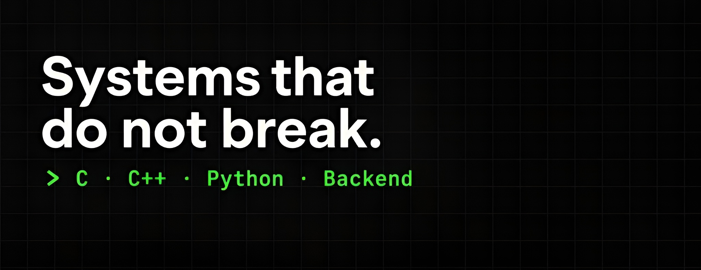
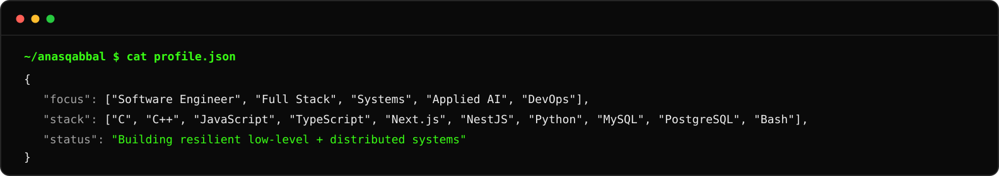

**Software engineer. Systems, backend, full-stack.** 
Building resilient low-level and distributed systems, from C and C++ to Next.js, NestJS, and applied AI.

## // featured

  
  

  
  

## // stats

  
  

